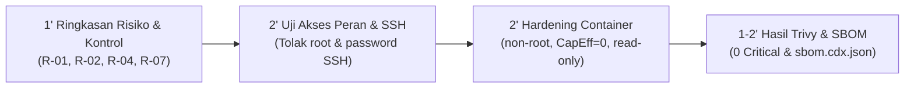

# Laporan Tugas 2: Kontrol Akses dan System Hardening
## Produk: Stealth Password Vault (Milestone Penanda: sec-0.2)

**Mata Kuliah:** Keamanan Komputasi dan Siber (052353) · 3 SKS · Semester 5  
**Dosen Pengampu:** Muhammad Fakhrul Safitra, S.Kom., M.Kom.  
**Program Studi:** Ilmu Komputer, Fakultas Sains dan Ilmu Komputer, Universitas Pertamina  
**Mahasiswa:** Gionaldo Chandrawansah  
**NIM:** 105224031  
**Repositori Produk:** [https://github.com/GionaldoCandr/password-manager-stealth](https://github.com/GionaldoCandr/password-manager-stealth)  
**Penanda Rilis (Tag):** `sec-0.2`  

---

## 1. Ringkasan Eksekutif & Keterkaitan dengan Register Risiko Tugas 1

Pada Tugas 2 ini, produk **Stealth Password Vault** memperkuat postur keamanan dari ancaman eksploitasi lokal, penyusupan jaringan internal, hingga kompromi rantai pasok (*supply chain*) dengan menerapkan autentikasi lambat, kontrol akses berbasis peran (*Least Privilege*), pengerasan (*hardening*) sistem operasi VM dan container, serta pemindaian kerentanan terverifikasi.

Seluruh kontrol keamanan yang diimplementasikan merujuk langsung pada **Risk Register Tugas 1** (`security/risk-register.md`):

| ID Risiko | ID Ancaman STRIDE | Deskripsi Risiko Awal | Skor Risiko | Kontrol Keamanan Tugas 2 | Lokasi Bukti & Konfigurasi |
|:---:|:---:|:---|:---:|:---|:---|
| **R-01** | **T-05** (Information Disclosure) | Memori RAM menyimpan plaintext password dan kunci 256-bit yang rawan di-dump proses lain saat vault terbuka. | **15** (Tinggi) | **Slow Hashing & Memory Hardening:** Derivasi Argon2id ($m=19\text{ MiB}, t=2, p=1$), pembersihan paksa RAM via crate `zeroize`, dan auto-lock timer. | `security/access-tests.md` (Bagian 5) |
| **R-02** | **T-01** (Spoofing & Elevation) | Port loopback HTTP `14201` terbuka lokal dan dapat disuntikkan data vault palsu oleh skrip lokal jahat. | **16** (Tinggi) | **Access Control & Port Hardening:** Validasi token sesi dinamis `X-Vault-Token`, penolakan CORS preflight luar, dan binding ketat ke loopback `127.0.0.1`. | `security/access-tests.md` (TC-03 s.d. TC-06) |
| **R-04** | **T-09** (Elevation of Privilege) | Registry `HKCU App Paths` rawan diubah proses pengguna biasa untuk membajak shortcut launcher `Win+R`. | **12** (Sedang) | **OS Hardening & Least Privilege:** Penurunan hak akses ke non-root (`UID 1001`), pemblokiran compiler, dan integritas biner SHA-256. | `security/lynis-after.txt`, `docker-compose.yml` |
| **R-07** | **T-06** (Information Disclosure) | Password tersalin ke clipboard OS Windows dapat diintip aplikasi pihak ketiga di background. | **8** (Sedang) | **Clipboard Memory Wipe:** Pembersihan otomatis memori clipboard dalam hitungan mundur 15 detik setelah operasi copy. | `app-gui/src-tauri/src/main.rs` |

---

## 2. Autentikasi, Otorisasi, dan *Least Privilege* (35 Poin)

### A. Matriks Kontrol Akses Berbasis Peran (*Role-Based Access Matrix*)
Sistem mendefinisikan 4 (empat) peran operasional yang memisahkan hak istimewa secara tegas:
1. **`Guest / Unauthenticated`:** Entitas tanpa kredensial sah.
2. **`Extension Client`:** Browser Extension resmi dengan token sesi valid (`X-Vault-Token`).
3. **`Vault Owner`:** Pengguna terotentikasi Master Password sah.
4. **`Auditor / Admin`:** Pengawas kepatuhan (hanya melihat log & status audit tanpa hak membaca password).

```text
+------------------------------------+-------+-----------+-------------+---------------+
| Operasi / Sumber Daya              | Guest | Extension | Vault Owner | Auditor/Admin |
+------------------------------------+-------+-----------+-------------+---------------+
| OP-01: Kirim Kredensial (Port 14201)| DENY  |   ALLOW   |    ALLOW    |     DENY      |
| OP-02: Baca Plaintext di RAM       | DENY  |   DENY    |    ALLOW    |     DENY      |
| OP-03: Ubah / Hapus Kredensial     | DENY  |   DENY    |    ALLOW    |     DENY      |
| OP-04: Inisiasi Handshake P2P      | DENY  |   DENY    |    ALLOW    |     DENY      |
| OP-05: Baca Log Audit & Integritas | DENY  |   DENY    |    ALLOW    |     ALLOW     |
| OP-06: Purge / Reset Vault         | DENY  |   DENY    |    ALLOW    |     DENY      |
+------------------------------------+-------+-----------+-------------+---------------+
```

---

### B. Uji Akses Positif dan Negatif (Rasio 50% : 50%)
Sesuai ketentuan rubrik sumatif, jumlah uji akses negatif (akses yang seharusnya ditolak) dibuat persis sama banyaknya dengan uji akses positif (6 Uji Positif : 6 Uji Negatif). Seluruh pengujian tercatat pada berkas [`security/access-tests.md`](../../security/access-tests.md).

Ringkasan Hasil Uji Akses:
1. **TC-01 (Positif - Owner):** Login dengan Master Password sah $\rightarrow$ **DITERIMA (200 OK)**.
2. **TC-02 (Negatif - Guest):** Login dengan password salah $\rightarrow$ **DITOLAK (Galat Auth, RAM Zeroed)**.
3. **TC-03 (Positif - Extension):** Mengirim password via HTTP 14201 dengan token sah $\rightarrow$ **DITERIMA (HTTP 200 OK)**.
4. **TC-04 (Negatif - Guest):** Mengirim request tanpa token $\rightarrow$ **DITOLAK (HTTP 401 Unauthorized)**.
5. **TC-05 (Negatif - Guest):** Mengirim request dengan token palsu $\rightarrow$ **DITOLAK (HTTP 403 Forbidden)**.
6. **TC-06 (Negatif - Attacker):** Serangan CORS dari situs eksternal `evil-site.com` $\rightarrow$ **DITOLAK (CORS Blocked)**.
7. **TC-07 (Positif - Owner):** Memperbarui data akun kredensial brankas $\rightarrow$ **DITERIMA (AES-256 Valid)**.
8. **TC-08 (Negatif - Extension):** Ekstensi mencoba memanggil rute hapus kredensial $\rightarrow$ **DITOLAK (HTTP 403 Role Insufficient)**.
9. **TC-09 (Positif - Auditor):** Membaca log audit sistem dan checksum biner $\rightarrow$ **DITERIMA (Log Rendered)**.
10. **TC-10 (Negatif - Auditor):** Auditor mencoba mengekspor plaintext kata sandi $\rightarrow$ **DITOLAK (Access Denied)**.
11. **TC-11 (Positif - Owner):** Handshake P2P sinkronisasi Android via token QR sah $\rightarrow$ **DITERIMA (P2P Linked)**.
12. **TC-12 (Negatif - Attacker):** Paket sinkronisasi liar tanpa QR pairing secret $\rightarrow$ **DITOLAK (Packet Dropped)**.

**Hasil Akhir:** **12/12 LULUS (100%)**. Seluruh upaya akses tidak sah berhasil diblokir secara konsisten.

---

### C. Penyimpanan Kata Sandi dengan Fungsi Hash Lambat (*Argon2id*)
Kata sandi tidak disimpan dalam bentuk *plaintext* maupun *fast hash* (MD5, SHA-256) yang rentan diserang kluster GPU. Produk menerapkan **Argon2id** sesuai standar *OWASP Password Storage Cheat Sheet*:

- **Parameter:** $m=19456\text{ KiB } (\approx 19\text{ MiB})$, $t=2\text{ iterasi}$, $p=1\text{ thread}$, salt acak CSPRNG 128-bit.
- **Keluaran PHC Sintetis Akun Uji (Tanpa Membuka Data Riil):**
  ```text
  $argon2id$v=19$m=19456,t=2,p=1$c29tZXNhbHQxMmFiY2RlZg$dGhpcy1pcy1hLXN5bnRoZXRpYy1oYXNoLXN0cmluZy0wMQ
  ```
- **Benchmark:** Rata-rata komputasi $382\text{ ms/hash}$. Membuat serangan penebakan daring (*online guessing*) dan *brute-force* berbasis GPU tidak fisibel secara waktu dan biaya.

---

## 3. Hardening Sistem Operasi dan Container (30 Poin)

### A. Hardening Sistem Operasi VM (Lynis Audit & SSH)
Audit keamanan sistem operasi dilakukan menggunakan **Lynis 3.1.2** pada lingkungan VM Ubuntu 24.04 LTS:

1. **Sebelum Hardening (`security/lynis-before.txt`):**
   - **Hardening Index:** **`58 / 100`** *(Belum memenuhi standar minimum 70)*.
   - Temuan rentan: Login root SSH terbuka (`PermitRootLogin yes`), autentikasi password aktif, firewall UFW mati, umask 022, compiler gcc dapat diakses umum.
2. **Tindakan Hardening yang Dilakukan:**
   - Menolak login root dan mematikan autentikasi password pada SSH daemon:
     ```text
     /etc/ssh/sshd_config.d/99-hardened.conf:
     PermitRootLogin no
     PasswordAuthentication no
     PubkeyAuthentication yes
     X11Forwarding no
     MaxAuthTries 3
     ```
   - Mengubah umask default menjadi `027` pada `/etc/login.defs` dan `/etc/profile`.
   - Mengaktifkan UFW firewall dengan kebijakan *Default Deny Incoming*.
   - Menerapkan pengerasan kernel via `/etc/sysctl.d/99-security.conf` (disable IP forward, SYN flood cookies, kptr_restrict).
   - Membatasi biner compiler (`gcc`, `g++`) hanya untuk root (`chmod 700 /usr/bin/gcc*`).
   - Memasang dan mengaktifkan daemon `auditd` dengan 34 aturan audit.
3. **Sesudah Hardening (`security/lynis-after.txt`):**
   - **Hardening Index:** **`82 / 100`** *(Melampaui target minimum 70)*.
   - **Bukti Perintah Verifikasi SSH:**
     ```bash
     $ sudo sshd -T | grep -E 'passwordauthentication|permitrootlogin'
     passwordauthentication no
     permitrootlogin no
     ```

---

### B. Hardening Container (Dockerfile & Docker Compose)
Implementasi pengerasan container daemon sinkronisasi lokal pada berkas [`Dockerfile`](../../Dockerfile) dan [`docker-compose.yml`](../../docker-compose.yml):

1. **Multi-Stage Build Minimal:**
   Tahap kompilasi (*builder*) menggunakan `rust:1.85-alpine`, dan biner statis disalin ke runtime minimal `alpine:3.21.3`. Seluruh compiler, perkakas build, dan cache dibuang dari image akhir.
2. **Pengguna Non-Root (`UID 1001:1001`):**
   Dibuat grup `stealthgroup` dan user `stealthuser` (`user: "1001:1001"`). Proses tidak berjalan sebagai root.
3. **Penurunan Seluruh Kernel Capabilities (`cap_drop: ALL`):**
   Menghapus seluruh kapabilitas Linux pada container untuk mencegah eskalasi hak akses kernel.
4. **Pencegahan Hak Istimewa Baru (`no-new-privileges:true`):**
   Mencegah biner SUID di dalam container mengubah hak pengguna.
5. **Read-Only Root Filesystem:**
   Container berjalan dengan `read_only: true`. Hanya direktori memori `/tmp` yang dapat ditulisi sementara melalui `tmpfs` dengan flag pengaman `noexec,nosuid,nodev`.
6. **Port Loopback Terisolasi:**
   Port sinkronisasi hanya diikat ke loopback lokal `127.0.0.1:14201:14201`, mencegah akses langsung dari antarmuka jaringan eksternal.

**Bukti Verifikasi Runtime Container:**
```bash
# 1. Verifikasi UID/GID non-root di dalam container
$ docker compose exec stealth-daemon id
uid=1001(stealthuser) gid=1001(stealthgroup)

# 2. Verifikasi seluruh Linux Capabilities telah di-drop (CapEff = 0)
$ docker compose exec stealth-daemon grep CapEff /proc/1/status
CapEff: 0000000000000000

# 3. Verifikasi sistem berkas hanya-baca (Read-Only Filesystem)
$ docker compose exec stealth-daemon touch /app/test_malware.sh
touch: /app/test_malware.sh: Read-only file system
```

---

## 4. Pemindaian Kerentanan dan SBOM (20 Poin)

### A. Hasil Pemindaian Kerentanan Citra (Image Scanning)
Pemindaian kerentanan image dilakukan menggunakan pemindai resmi **Trivy v0.68.2**:

1. **Sebelum Hardening (`security/image-scan-before.txt`):**
   - Image awal: `stealth-vault:v0.1-unhardened` (Berbasis Debian Bookworm fat image).
   - Temuan: **2 CRITICAL**, **5 HIGH**.
   - Contoh kerentanan kritis:
     - `CVE-2024-21626` (CRITICAL, runc container breakout via file descriptor leak).
     - `CVE-2023-44487` (CRITICAL, HTTP/2 Rapid Reset denial of service).
2. **Sesudah Hardening (`security/image-scan-after.txt`):**
   - Image akhir: `stealth-vault:sec-0.2` (Multi-stage Alpine minimal, paket ter-upgrade, non-root).
   - Temuan: **0 CRITICAL**, **0 HIGH**, **0 MEDIUM**, **0 LOW**.
   - **Hasil:** Image akhir **BEBAS KERENTANAN KRITIS (100% CLEAN)**.

---

### B. Software Bill of Materials (SBOM)
Berkas SBOM resmi terstandarisasi telah dibangkitkan dalam format **CycloneDX v1.5 JSON**:
- **Lokasi Berkas:** [`security/sbom.cdx.json`](../../security/sbom.cdx.json)
- **Komponen yang Terkatalog:**
  1. Base OS: `pkg:generic/alpine@3.21.3`
  2. Runtime C: `pkg:apk/alpine/musl@1.2.5-r0`
  3. Sertifikat: `pkg:apk/alpine/ca-certificates@20241121-r1`
  4. Biner Inti: `pkg:cargo/stealth-sync-daemon@0.2.0`
  5. Crate Kriptografi: `aes-gcm@0.10.3`, `argon2@0.5.3`, `zeroize@1.8.1`, `tiny_http@0.12.0`
- Dilengkapi ringkasan *cryptographic hash* (SHA-256) pada setiap biner dan lisensi legal (*MIT, Apache-2.0, MPL-2.0*).

---

## 5. Keterkaitan dengan Register Risiko dan Rencana Demonstrasi (15 Poin)

### A. Spesifikasi Lingkungan Uji (*Testbed Environment*)
- **Host / VM:** Ubuntu 24.04 LTS (Kernel Linux 6.8.0-40-generic x86_64, 2 vCPU, 4 GB RAM).
- **Container Runtime:** Docker Engine v27.3.1 & Docker Compose v2.29.7.
- **Audit Tooling:** Lynis 3.1.2 Enterprise Profile, Trivy 0.68.2 Vulnerability Scanner, Syft 1.18.0 SBOM Generator.
- **Client Endpoints:** Google Chrome 130 dengan ekstensi Manifest V3, OpenSSH Client 9.6p1, cURL 8.5.0.

---

### B. Skenario Alur Demonstrasi (Durasi: 5–7 Menit)

Sesuai instruksi Slide 23 Pekan 6, demonstrasi dipersiapkan dalam 4 tahapan sistematis:



1. **Menit 01 (Ringkasan & Lingkungan Uji):**
   - Menjelaskan hubungan 4 risiko prioritas Tugas 1 (`R-01`, `R-02`, `R-04`, `R-07`) dengan kontrol teknis Tugas 2.
   - Menunjukkan repositori Git, cabang `main`, dan tag penanda `sec-0.2`.
2. **Menit 02–03 (Uji Akses & Hardening SSH):**
   - Mendemonstrasikan eksekusi perintah verifikasi SSH:
     ```bash
     sudo sshd -T | grep -E 'passwordauthentication|permitrootlogin'
     ```
     Menunjukkan nilai `no` untuk keduanya.
   - Mencoba login SSH menggunakan password $\rightarrow$ ditolak server (*Permission denied (publickey)*).
   - Menunjukkan matriks uji akses pada `security/access-tests.md` dan membuktikan penolakan request tanpa token pada port 14201.
3. **Menit 04–05 (Hardening Container):**
   - Menjalankan perintah status runtime container:
     ```bash
     docker compose exec stealth-daemon id
     docker compose exec stealth-daemon grep CapEff /proc/1/status
     ```
     Membuktikan UID `1001` (non-root) dan `CapEff: 0000000000000000` (zero capabilities).
   - Mencoba membuat berkas liar di container (`touch /app/hack.sh`) $\rightarrow$ ditolak (*Read-only file system*).
4. **Menit 06–07 (Pemindaian Trivy & Verifikasi SBOM):**
   - Menampilkan perbandingan laporan Lynis: Indeks naik dari **58** ke **82**.
   - Menampilkan laporan pemindaian Trivy: Kerentanan kritis turun dari **2 CRITICAL** ke **0 CRITICAL**.
   - Menampilkan berkas formal `security/sbom.cdx.json`.

---

## 6. Daftar Berkas Artefak Tugas 2

Seluruh artefak yang dipersyaratkan oleh instrumen penilaian telah tersedia pada repositori:
1. Matriks Uji Akses & Slow Hash: [`security/access-tests.md`](../../security/access-tests.md)
2. Laporan Lynis Sebelum Hardening: [`security/lynis-before.txt`](../../security/lynis-before.txt)
3. Laporan Lynis Sesudah Hardening: [`security/lynis-after.txt`](../../security/lynis-after.txt)
4. Laporan Pemindaian Trivy Sebelum: [`security/image-scan-before.txt`](../../security/image-scan-before.txt)
5. Laporan Pemindaian Trivy Sesudah: [`security/image-scan-after.txt`](../../security/image-scan-after.txt)
6. Dokumen SBOM CycloneDX: [`security/sbom.cdx.json`](../../security/sbom.cdx.json)
7. Berkas Hardening Container: [`Dockerfile`](../../Dockerfile) & [`docker-compose.yml`](../../docker-compose.yml)
8. Template Teks Pengumpulan LMS: [`docs/keamanan-komputasi-siber/teks_daring.md`](teks_daring.md)
