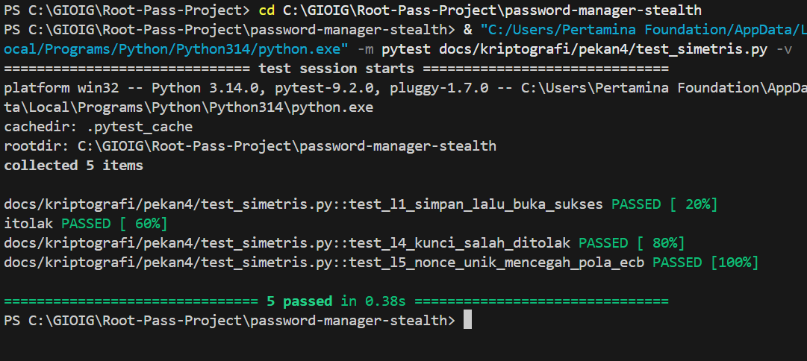

# Laporan Latihan Pekan 4 — Komponen Simetris
## Password Stealth Vault

- **Nama Mahasiswa:** Gionaldo Chandrawansah  
- **NIM:** 105224031  
- **Mata Kuliah:** Kriptografi (052357) · 2 SKS · Semester 5  
- **Dosen Pengampu:** Muhammad Fakhrul Safitra, S.Kom., M.Kom.  
- **Program Studi:** Ilmu Komputer, Universitas Pertamina  
- **Produk:** Stealth Password Vault  
- **Cabang Git:** `latihan-4`  

---

## 1. Tautan Repositori & Berkas
- **Cabang Latihan:** `latihan-4`
- **Tautan Repositori:** [https://github.com/GionaldoCandr/password-manager-stealth/tree/latihan-4](https://github.com/GionaldoCandr/password-manager-stealth/tree/latihan-4)
- **Berkas Modul:**
  - `docs/kriptografi/pekan4/simetris.py` (Fungsi inti AES-256-GCM)
  - `docs/kriptografi/pekan4/vault_entry.py` (Penghubung entri kredensial dan AAD)
  - `docs/kriptografi/pekan4/test_simetris.py` (Test suite pytest)

---

## 2. Penjelasan Data, AAD, dan Alasan Pemilihan AES-GCM (Slide 34)

### A. Data yang Dienkripsi
Data yang dilindungi kerahasiaannya adalah **String Kata Sandi Akun (*plaintext password*)** yang disimpan oleh pengguna. Kata sandi ini diubah menjadi *bytes* UTF-8 sebelum diproses oleh cipher simetris.

### B. Pemilihan Konteks AAD (Additional Authenticated Data)
Konteks yang diikatkan sebagai AAD adalah **`situs:username`** (contoh: `bca.co.id:nasabah123`):
- **Tujuan AAD:** AAD adalah data yang diautentikasi integritasnya namun tidak dienkripsi.
- **Mitigasi Ancaman (*Ciphertext Transplant Attack*):** Jika penyerang menyalin *ciphertext* kata sandi dari satu akun dan menempelkannya ke akun lain milik korban, proses dekripsi akan **otomatis gagal (`InvalidTag`)** karena AAD (`situs:username`) tidak cocok, meskipun kunci induknya sama.

### C. Alasan Memilih Mode AES-GCM (Bukan ECB atau CBC)
1. **Authenticated Encryption with Associated Data (AEAD):** AES-GCM memberikan **kerahasiaan sekaligus integritas dan autentisitas** dalam satu langkah komputasi matematis yang efisien.
2. **Bukan ECB:** Mode ECB bersifat deterministik dan membocorkan pola struktur data plaintext.
3. **Bukan CBC:** Mode CBC memerlukan skema padding (PKCS#7) yang rentan terhadap serangan *Padding Oracle Attack* (Vaudenay, 2002) dan serangan *bit-flipping* jika tidak dikombinasikan dengan HMAC terpisah (*Encrypt-then-MAC*). Pada GCM, serangan *bit-flipping* langsung menggagalkan *Authentication Tag* (128-bit) dan memicu penolakan seketika.

---

## 3. Analisis Singkat Kasus Mode Operasi

### Kasus 1: Pola ECB (Electronic Codebook)
- **Mekanisme & Kelemahan:** Pada mode ECB, setiap blok plaintext 128-bit dienkripsi secara independen dengan kunci yang sama ($C_i = E_K(P_i)$). Akibatnya, dua blok plaintext yang identik akan selalu menghasilkan blok ciphertext yang identik. Mode ini gagal total memenuhi standar keamanan CPA (*Chosen-Plaintext Attack*).
- **Studi Kasus Nyata:** Investigasi Citizen Lab (2020) terhadap enkripsi media Zoom yang menggunakan mode ECB menunjukkan bahwa pola visual gambar/video tetap terlihat jelas pada data terenkripsi. Pada konteks *password manager*, jika pengguna memakai sandi yang sama atau berpola serupa di beberapa layanan, penyerang yang memantau brankas dapat mendeteksi kesamaan tersebut hanya dari ciphertext tanpa perlu membobol kunci.

### Kasus 2: Bahaya Penggunaan IV/Nonce Berulang (*Nonce Reuse*)
- **Mekanisme & Kelemahan:** Mode CTR dan GCM mengubah block cipher menjadi stream cipher dengan menghasilkan *keystream* ($S_i = E_K(\text{nonce} \parallel i)$). Ciphertext dihasilkan melalui operasi XOR: $C_i = P_i \oplus S_i$.
- **Bencana Two-Time Pad:** Jika pasangan $(\text{kunci}, \text{nonce})$ digunakan berulang untuk dua pesan berbeda ($P_1$ dan $P_2$), maka:
  $$C_1 \oplus C_2 = (P_1 \oplus S) \oplus (P_2 \oplus S) = P_1 \oplus P_2$$
  Keystream saling meniadakan. Penyerang yang mengetahui struktur atau format salah satu pesan ($P_1$) dapat memulihkan pesan lainnya ($P_2$) secara langsung tanpa mengetahui kunci rahasia (*Known-Plaintext Attack*).
- **Dampak Fatal pada GCM:** Pada AES-GCM, penggunaan ulang nonce bahkan membocorkan kunci hash Galois ($H$), yang memungkinkan penyerang memalsukan tag autentikasi untuk pesan apa pun.
- **Solusi pada Produk:** Menghasilkan nonce 96-bit (12 byte) baru dan unik untuk setiap operasi enkripsi menggunakan CSPRNG OS (`os.urandom(12)`).

---

## 4. Hasil Eksekusi Pengujian Pytest

Pengujian dijalankan pada terminal Windows menggunakan `pytest`:

```text
============================= test session starts =============================
platform win32 -- Python 3.14.0, pytest-9.2.0, pluggy-1.7.0 -- python.exe
cachedir: .pytest_cache
rootdir: C:\GIOIG\Root-Pass-Project
collecting ... collected 5 items

password-manager-stealth/docs/kriptografi/pekan4/test_simetris.py::test_l1_simpan_lalu_buka_sukses PASSED [ 20%]
password-manager-stealth/docs/kriptografi/pekan4/test_simetris.py::test_l2_paket_diubah_ditolak PASSED [ 40%]
password-manager-stealth/docs/kriptografi/pekan4/test_simetris.py::test_l3_catatan_dipindah_ke_situs_lain_ditolak PASSED [ 60%]
password-manager-stealth/docs/kriptografi/pekan4/test_simetris.py::test_l4_kunci_salah_ditolak PASSED [ 80%]
password-manager-stealth/docs/kriptografi/pekan4/test_simetris.py::test_l5_nonce_unik_mencegah_pola_ecb PASSED [100%]

============================== 5 passed in 0.37s ==============================
```

> **Dokumentasi Tangkapan Layar Pengujian:**  
> 

---

## 5. Ringkasan Kasus Uji

| No | Nama Fungsi Uji | Kategori | Penjelasan Perilaku Kriptografi | Status |
| :---: | :--- | :---: | :--- | :---: |
| 1 | `test_l1_simpan_lalu_buka_sukses` | Positif | Enkripsi menghasilkan ciphertext terisolasi dan dapat didekripsi kembali secara sempurna. | **PASSED** |
| 2 | `test_l2_paket_diubah_ditolak` | Negatif | Membalik 1 bit ciphertext memicu kegagalan integritas `InvalidTag`. | **PASSED** |
| 3 | `test_l3_catatan_dipindah_ke_situs_lain_ditolak` | Negatif (AAD) | Membuka ciphertext dengan konteks situs berbeda ditolak oleh AAD verification. | **PASSED** |
| 4 | `test_l4_kunci_salah_ditolak` | Negatif | Kunci enkripsi dan dekripsi yang tidak cocok memicu `InvalidTag`. | **PASSED** |
| 5 | `test_l5_nonce_unik_mencegah_pola_ecb` | Keacakan | Password sama menghasilkan ciphertext berbeda karena nonce acak baru. | **PASSED** |

