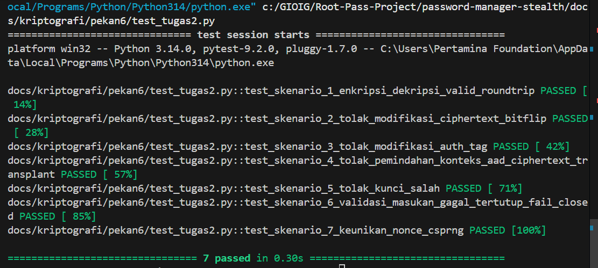

# Laporan Tugas 2 — Enkripsi Terautentikasi dan Integritas Data
## Password Stealth Vault (Milestone Tag: `v0.2`)

- **Nama Mahasiswa:** Gionaldo Chandrawansah  
- **NIM:** 105224031  
- **Mata Kuliah:** Kriptografi (052357) · 2 SKS · Semester 5  
- **Dosen Pengampu:** Muhammad Fakhrul Safitra, S.Kom., M.Kom.  
- **Program Studi:** Ilmu Komputer, Universitas Pertamina  
- **Produk Digital:** Stealth Password Vault  
- **Tag Pengumpulan:** `v0.2`  
- **Tautan Repositori:** [https://github.com/GionaldoCandr/password-manager-stealth](https://github.com/GionaldoCandr/password-manager-stealth)

---

## 1. Ringkasan Tugas & Berkas Repositori

Tugas 2 berfokus pada penerapan **Enkripsi Terautentikasi (AEAD)** dan **Integritas Data** pada produk Password Stealth Vault menggunakan pustaka kriptografi yang terpelihara secara aktif (`cryptography`).

### Struktur Berkas Modul Pekan 6:
| Nama Berkas | Peran & Deskripsi |
|---|---|
| [`KEPUTUSAN.md`](KEPUTUSAN.md) | Dokumen keputusan arsitektur (ADR): Kebutuhan $\rightarrow$ Mekanisme $\rightarrow$ Alasan, perbandingan 4 pilar kriptografi, dan kepatuhan standar NIST SP 800-38D. |
| [`aead.py`](aead.py) | Mesin kriptografi inti AES-256-GCM: Nonce 96-bit CSPRNG, Tag 128-bit, AAD context binding, Base64 payload serializer, dan penanganan *fail-closed*. |
| [`kdf.py`](kdf.py) | Fungsi derivasi kunci: PBKDF2-HMAC-SHA256 (600.000 iterasi) untuk Master Password & HKDF (RFC 5869) untuk *Cryptographic Key Separation*. |
| [`vault_security.py`](vault_security.py) | Layanan integrasi tingkat tinggi: pengelolaan kunci di luar repositori (`STEALTH_VAULT_MASTER_KEY`), pengikatan AAD (`situs:username`), enkripsi & dekripsi entri brankas. |
| [`test_tugas2.py`](test_tugas2.py) | Rangkaian 7 skenario pengujian unit komprehensif berbasis `pytest` (100% lulus). |
| [`AI_LOG.md`](AI_LOG.md) | Log audit transparansi penggunaan asisten kecerdasan buatan (AI) sesuai rubrik K5. |
| [`teks_daring.md`](teks_daring.md) | Teks siap salin-tempel untuk pengumpulan pada LMS e-learning Universitas Pertamina. |

---

## 2. Parameter Kriptografi Terdokumentasi (Memenuhi Rubrik K2)

| Parameter | Spesifikasi | Keterangan & Standar |
|---|---|---|
| **Algoritma Utama** | AES-256-GCM | NIST SP 800-38D (Authenticated Encryption with Associated Data) |
| **Panjang Kunci** | 256 bit (32 byte) | Dibangkitkan via CSPRNG `os.urandom(32)`, bebas dari *weak keys*. |
| **Ukuran Nonce / IV** | 96 bit (12 byte) | Unik per enkripsi via CSPRNG, mencegah bencana *Two-Time Pad*. |
| **Panjang Authentication Tag** | 128 bit (16 byte) | Ukuran tag maksimum NIST untuk mencegah pemalsuan tag. |
| **Associated Data (AAD)** | `situs:username` | Format UTF-8 bytes untuk mencegah serangan *Ciphertext Transplant*. |
| **Sifat Penanganan Masukan** | Gagal Tertutup (*Fail-Closed*) | Melempar `InvalidTag` atau `ValueError`, data rusak langsung ditolak seketika. |
| **Lokasi Kunci** | Di luar Repositori Git | Melalui *Environment Variable* sistem host (`STEALTH_VAULT_MASTER_KEY`). |

---

## 3. Hasil Pengujian Unit (Memenuhi Rubrik K4)

Pengujian dilakukan menggunakan framework `pytest` dengan 7 skenario komprehensif:

1. **Skenario 1 (Positif):** Enkripsi dan dekripsi roundtrip berhasil mengembalikan plaintext asli secara utuh.
2. **Skenario 2 (Negatif):** Modifikasi 1 bit pada ciphertext (*bit-flipping attack*) ditolak dengan `InvalidTag`.
3. **Skenario 3 (Negatif):** Manipulasi byte pada *Authentication Tag* 128-bit ditolak dengan `InvalidTag`.
4. **Skenario 4 (Negatif):** Pemindahan ciphertext ke domain situs/pengguna lain (*AAD mismatch*) ditolak dengan `InvalidTag`.
5. **Skenario 5 (Negatif):** Dekripsi menggunakan kunci simetris yang salah ditolak dengan `InvalidTag`.
6. **Skenario 6 (Batas/Edge):** Plaintext kosong, tipe masukan salah, dan payload Base64 rusak gagal tertutup dengan melempar `ValueError`.
7. **Skenario 7 (Kriptografis):** Uji empiris keunikan nonce membuktikan 500 nonce berturut-turut menghasilkan 500 nilai unik tanpa tabrakan.

### Perintah Menjalankan Pengujian:
```bash
# Menggunakan pytest langsung
pytest docs/kriptografi/pekan6/test_tugas2.py -v

# Atau mengeksekusi berkas python secara langsung
python docs/kriptografi/pekan6/test_tugas2.py
```

### Log Luaran Eksekusi Terminal:
```text
============================= test session starts =============================
platform win32 -- Python 3.14.0, pytest-9.2.0, pluggy-1.7.0 -- C:\Users\Pertamina Foundation\AppData\Local\Programs\Python\Python314\python.exe
cachedir: .pytest_cache
rootdir: C:\GIOIG\Root-Pass-Project
collecting ... collected 7 items

password-manager-stealth/docs/kriptografi/pekan6/test_tugas2.py::test_skenario_1_enkripsi_dekripsi_valid_roundtrip PASSED [ 14%]
password-manager-stealth/docs/kriptografi/pekan6/test_tugas2.py::test_skenario_2_tolak_modifikasi_ciphertext_bitflip PASSED [ 28%]
password-manager-stealth/docs/kriptografi/pekan6/test_tugas2.py::test_skenario_3_tolak_modifikasi_auth_tag PASSED [ 42%]
password-manager-stealth/docs/kriptografi/pekan6/test_tugas2.py::test_skenario_4_tolak_pemindahan_konteks_aad_ciphertext_transplant PASSED [ 57%]
password-manager-stealth/docs/kriptografi/pekan6/test_tugas2.py::test_skenario_5_tolak_kunci_salah PASSED [ 71%]
password-manager-stealth/docs/kriptografi/pekan6/test_tugas2.py::test_skenario_6_validasi_masukan_gagal_tertutup_fail_closed PASSED [ 85%]
password-manager-stealth/docs/kriptografi/pekan6/test_tugas2.py::test_skenario_7_keunikan_nonce_csprng PASSED [100%]

============================== 7 passed in 0.29s ==============================
```

> **Dokumentasi Tangkap Layar Pengujian:**
> 
> <!-- TANGKAP LAYAR HASIL UJI PYTEST DISINI -->
> 

---

## 4. Panduan Demonstrasi Individual (±3 Menit)

Berikut adalah panduan materi dan alur bicara saat demonstrasi langsung di hadapan dosen pengampu:

### Menit 1: Lokasi Penyimpanan Kunci (*Zero Secrets in Repository*)
- **Tunjukkan Berkas `.gitignore`:** Tunjukkan bahwa berkas `.env`, `*.key`, dan direktori rahasia dikecualikan dari Git.
- **Tunjukkan Kelas `VaultKeyManager` pada `vault_security.py`:**
  Jelaskan bahwa kunci dibangkitkan menggunakan CSPRNG sistem (`os.urandom(32)`) dan hanya dibaca dari *Environment Variable* host (`STEALTH_VAULT_MASTER_KEY`) atau diturunkan melalui PBKDF2/HKDF saat runtime. Tidak ada token atau kunci yang tersimpan permanen di repositori kode.
  
> <!-- TANGKAP LAYAR DEMONSTRASI PENYIMPANAN KUNCI DISINI -->

### Menit 2: Bahaya Penggunaan Nonce Berulang (*Nonce Reuse Hazard*)
- **Jelaskan Konsep Matematis Two-Time Pad:**
  Pada AES-GCM (yang berbasis CTR mode), ciphertext dibentuk dari operasi XOR antara plaintext dan keystream:
  $$C_1 = P_1 \oplus \text{keystream}, \quad C_2 = P_2 \oplus \text{keystream}$$
  Jika nonce berulang untuk kunci yang sama, keystream identik:
  $$C_1 \oplus C_2 = P_1 \oplus P_2$$
  Hal ini menyebabkan hilangnya kerahasiaan (*CPA insecure*). Lebih parah lagi, pada GCM, penyerang dapat merekonstruksi *hash key* ($H$) GHASH dan memalsukan tag autentikasi untuk pesan apa pun.
- **Tunjukkan Implementasi Solusi:** Pada `aead.py`, baris `nonce = os.urandom(12)` menjamin keacakan murni 96-bit untuk setiap enkripsi baru.

### Menit 3: Eksekusi Uji & Peran AAD Mencegah *Ciphertext Transplant*
- **Jalankan Terminal:** Ketik `python docs/kriptografi/pekan6/test_tugas2.py` dan perlihatkan 7 tes sukses (*all green*).
- **Sorot Skenario 4 (AAD Mismatch):** Jelaskan bahwa meskipun kunci dan ciphertext valid, jika konteks `situs:username` dipindahkan, verifikasi GMAC melempar `InvalidTag` dan proses dekripsi gagal seketika (*fail-closed*).
